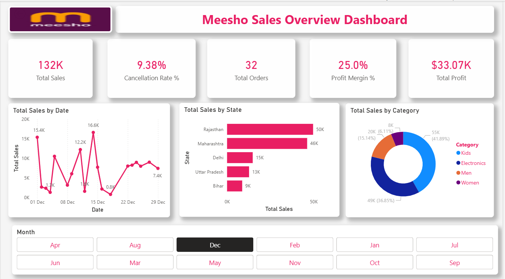
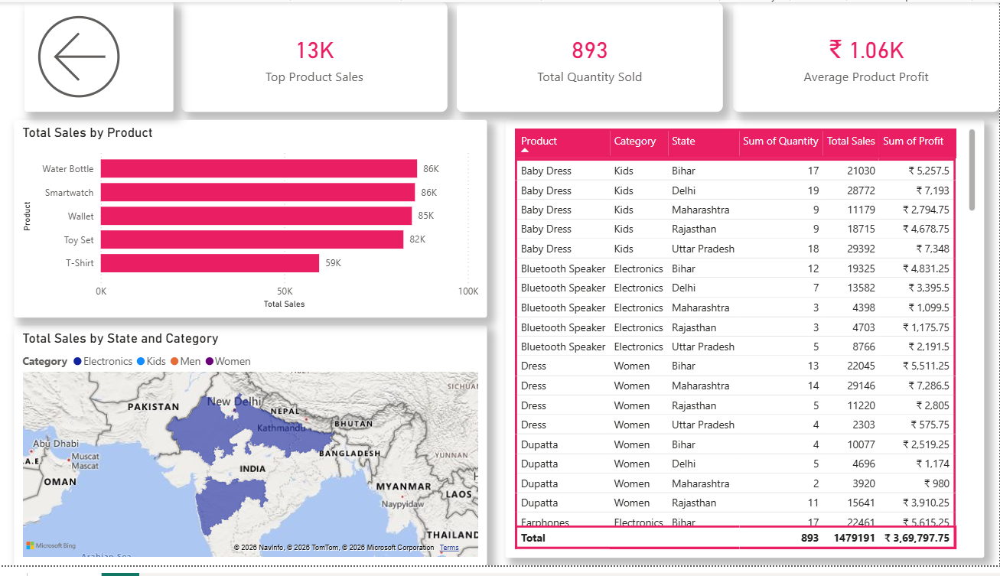

# 🛍️ Meesho Sales Overview Dashboard | Power BI

**From scattered sales data to a story you can see.**

An interactive **Power BI Dashboard** developed to analyze e-commerce sales data and explore business performance through KPIs, trends, product insights, and regional analysis.

This project transforms raw sales records into meaningful visual insights, helping understand sales performance, product trends, and business patterns.

## 📌 Project Overview

The Meesho Sales Overview Dashboard is a data analytics project built using Microsoft Power BI. It focuses on exploring sales data, identifying important business trends, and presenting key performance indicators through interactive visualizations.

The dashboard provides a consolidated view of sales performance and allows users to explore different aspects of the dataset.

## 🎯 Project Objectives

- Analyze overall sales performance.
- Track important sales KPIs.
- Understand sales trends and patterns.
- Identify high-performing products and categories.
- Compare sales performance across regions.
- Explore business performance using interactive filters.
- Convert raw transactional data into meaningful insights.

## 🛠️ Tools & Technologies

| Tool | Purpose |
|---|---|
| Power BI | Dashboard development |
| Power Query | Data cleaning and transformation |
| DAX | Measures and calculations |
| CSV | Dataset |
| Data Visualization | Presenting business insights |

## 📊 Dashboard Preview

### Page 1 – Sales Overview

This page presents the key sales indicators and visual summaries to understand overall business performance.



### Page 2 – Sales Analysis

This page provides additional visual analysis to explore sales patterns and compare different business dimensions.



## ✨ Key Dashboard Highlights

- **Sales Performance:** Overview of important sales metrics.
- **Growth Trends:** Explore sales patterns over time.
- **Product Insights:** Analyze product and category performance.
- **Regional Analysis:** Compare performance across locations.
- **Interactive Exploration:** Use dashboard filters and slicers to investigate the data.

## 🔄 Project Workflow

```text
Raw Sales Dataset (CSV)
          ↓
Data Import into Power BI
          ↓
Data Cleaning using Power Query
          ↓
Data Transformation
          ↓
Data Modeling
          ↓
DAX Measures
          ↓
Dashboard Development
          ↓
Interactive Sales Analysis
          ↓
Business Insights
```

## 📈 Project Outcome

The dashboard provides a visual overview of e-commerce sales performance and makes it easier to explore business trends, product performance, and regional patterns.

It demonstrates practical skills in data preparation, business intelligence, dashboard development, and data visualization using Power BI.

## 🚀 How to View the Project

1. Download the Power BI file from this repository.
2. Install and open Microsoft Power BI Desktop.
3. Open the downloaded `.pbix` file.
4. Explore both dashboard pages and interact with the available filters.

**Power BI Dashboard:** [Download hr dashboard 1.pbix](hr%20dashboard%201.pbix)

## 📂 Repository Structure

```text
messho-sales-overview-dashboard/
│
├── README.md
├── Meesho_Sales_Dataset_350Rows.csv
├── hr dashboard 1.pbix
├── messho-page1.png
└── messho-page2.png
```

## 📌 Project Category

Data Analytics | Business Intelligence | Power BI | Sales Analysis | Data Visualization

## 👩‍💻 Author

**Tasneem Fatma**

MCA Student | Aspiring Software Developer | Data Analytics Enthusiast

- GitHub: [TasneemFatma012](https://github.com/TasneemFatma012)
- Project Repository: [Meesho Sales Overview Dashboard](https://github.com/TasneemFatma012/messho-sales-overview-dashboard)

---

⭐ If you find this project interesting, feel free to explore the repository!

**Data is just numbers until you know what story it's telling.** 📊
